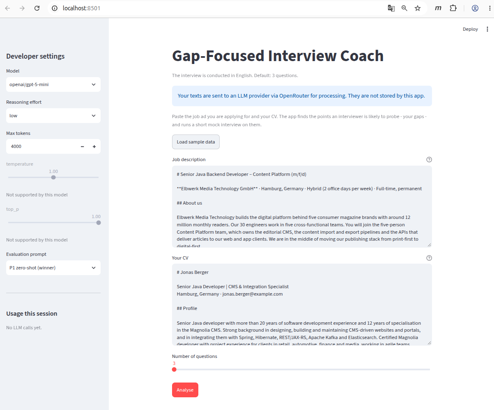
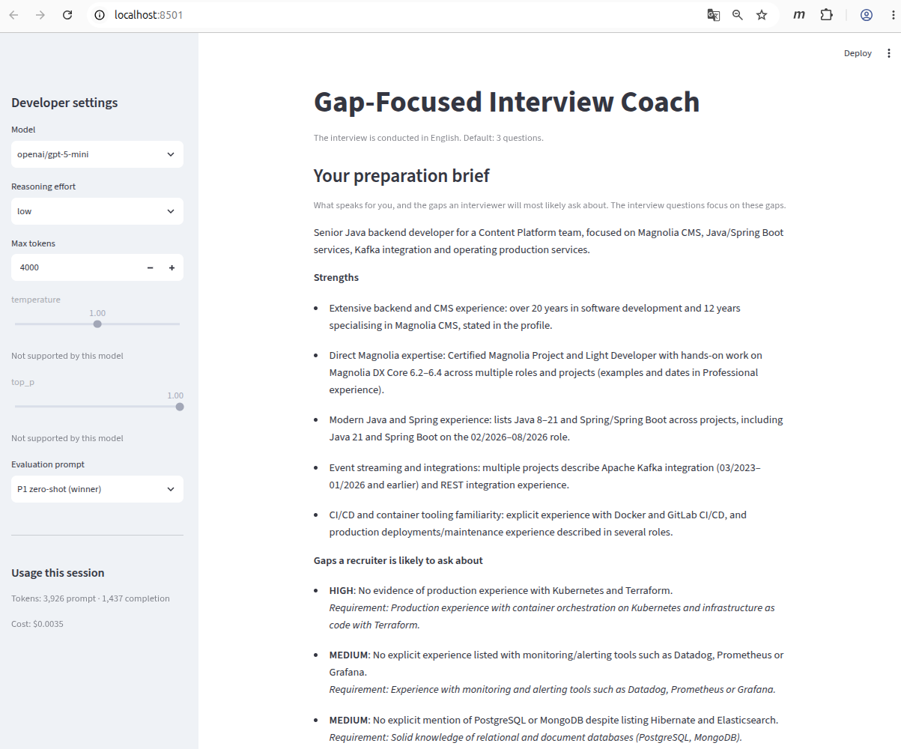
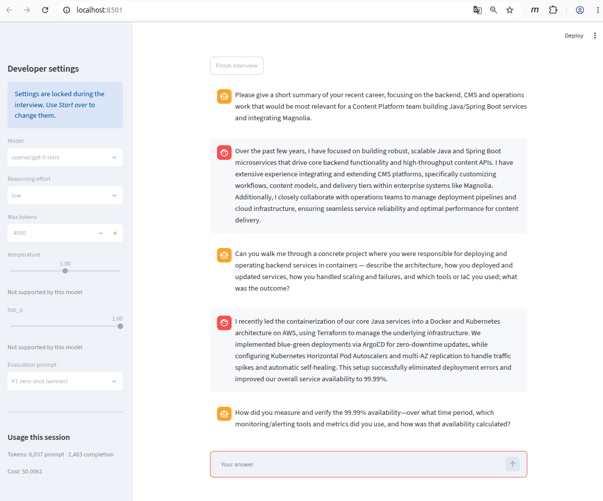
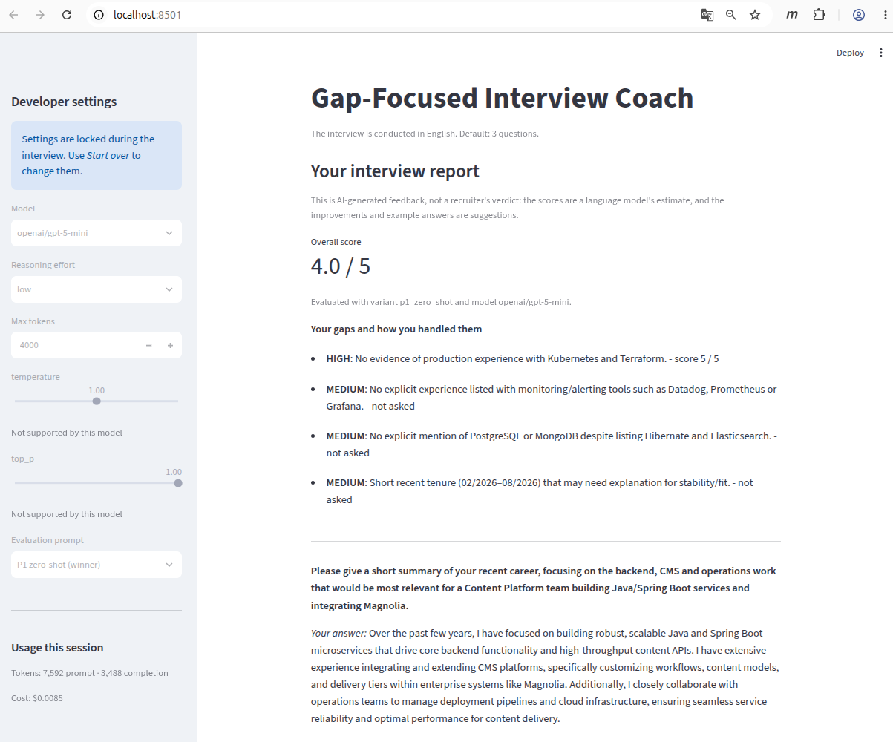

# Gap-Focused Interview Coach

A Streamlit app that prepares a candidate for one specific job interview. Turing College,
AI Engineering, Sprint 1. The authoritative design document is
[`PRODUCT_SPEC.md`](PRODUCT_SPEC.md) (v0.2.6).

## Purpose

The user pastes a **job description** (JD) and their **CV**. The app then

1. analyses where the CV matches the job and where it has **gaps** — missing skills, short
   tenures or unexplained career steps, weak evidence,
2. runs a short **mock interview as a chat**: the planned questions target those gaps, and an LLM
   interviewer that sees the whole conversation asks **follow-up questions**,
3. evaluates **each answer** with an LLM acting as judge against an explicit rubric, using the
   STAR method for behavioural questions, and
4. shows a **feedback report** with scores, strengths, concrete improvements and an improved
   example answer.

The engineering focus is not the feature count but a measurable comparison of five prompting
techniques for the answer-evaluation task, a documented model-settings experiment, and a layered
security guard.

**Current state.** The path `SETUP → BRIEF → INTERVIEW → REPORT` runs end to end. All five
evaluation variants P1–P5 are implemented and were compared in a full evaluation run; P1
(zero-shot) won and is the default. Prices come from the OpenRouter models endpoint, and the
evaluation harness reports the cost per evaluation. The developer sidebar holds model, reasoning
effort, max tokens, the evaluation variant and the session's token and cost total; it is locked
once the interview starts. Before the analysis, a cheap classifier call checks that the inputs
really are a job description and a CV. The table below is derived from the code, not from the spec.

| ID | Requirement | Status | Notes |
|---|---|---|---|
| FR-01 | Text input for JD and CV | implemented | Limits enforced: JD 8,000, CV 12,000 characters |
| FR-02 | Sample data | implemented | Fictional JD and CV in `data/samples/` |
| FR-03 | Number of questions | implemented | Slider 3–8, default 3 |
| FR-04 | Gap analysis | implemented | Role summary, strengths and gaps with severity |
| FR-05 | Main question planning | implemented | Question mix, gap references and duplicate texts re-checked in `interview._validate_plan` |
| FR-06 | Chat-based interview | implemented | Includes early "Finish interview" |
| FR-07 | Adaptive follow-up | implemented | Multi-turn, streamed, after `gap` questions only |
| FR-08 | Per-answer evaluation | implemented | All five variants P1–P5; P4 and P5 make two calls each. Default is P1, the winner of the evaluation run |
| FR-09 | Report | implemented | Overall score computed in Python, no extra LLM call |
| FR-10 | Separated developer settings | implemented | All LLM controls in the sidebar; the main page works on defaults. At `BRIEF → INTERVIEW` the settings are frozen into a `RunConfig`, the controls are disabled and the lock notice is shown; the cost total stays visible |
| FR-11 | Model and parameter controls | implemented | Model (the three allowed models), reasoning effort and max tokens; `temperature` and `top_p` are shown but disabled with "Not supported by this model", because none of the allowed models lists them in `supported_parameters` |
| FR-12 | Prompt variant selector | implemented | Selector for P1–P5 in the sidebar; default P1, the winner of the evaluation run |
| FR-13 | Token usage and cost | implemented | Every LLM call (follow-ups included) adds its prompt and completion tokens and its cost to a session total in the sidebar; prices come from the OpenRouter models endpoint, and "Cost: unavailable" is shown when they cannot be fetched |
| FR-14 | Layered security guard | implemented | All four layers L1–L4 are active; the L3 classifier rejects documents that are not a job ad or a CV or that contain instructions to an AI, and the analysis goes ahead if the classifier call fails; 14 security test cases in `docs/security_tests.md` and `.xlsx` (AC5) |
| FR-15 | Privacy handling | implemented | Notice shown, data kept in `st.session_state` only, key read from the environment; opt-in debug log for development only (AC5) |

## Screenshots

One run with the fictional sample data and three questions.

**1 — SETUP.** Job description and CV (here the sample data), the number of questions, the privacy
notice and a one-sentence explanation of what the app does. The developer settings in the sidebar show the defaults; `temperature` and `top_p` are
disabled because the allowed models do not support them.



**2 — BRIEF.** The preparation brief from the analysis call: role summary, strengths, and the gaps
with their severity and the job requirement each relates to. The sidebar shows the tokens and the
cost of the analysis call.



**3 — INTERVIEW.** The mock interview as a chat. After the answer to a gap question, the
interviewer asks a follow-up that picks up a concrete claim from the answer (here the "99.99 %
availability"). The settings are locked for the rest of the run, and the session total keeps
counting.



**4 — REPORT.** A note that the scores are AI feedback, the overall score, the gaps next to the
scores of the questions that targeted them ("not asked" for gaps no question targeted),
and per question the answers and the evaluation; the caption names the variant and the model.



## Setup

Requires Python 3.13, [uv](https://docs.astral.sh/uv/) and an OpenRouter API key. The project is
uv-only; bare `pip` or `python` are not used.

```bash
git clone https://github.com/ijaeg/job-interview-coaching-app.git
cd job-interview-coaching-app
uv sync                                 # install dependencies from uv.lock
cp .env.example .env                    # then set OPENROUTER_API_KEY=... in .env
uv run streamlit run app.py             # start the app
```

The key may equally be exported as an environment variable instead of using `.env`; a real
environment variable takes precedence over the file. `.env` is listed in `.gitignore`, and the
key appears neither in the repository nor in the UI (FR-15 AC3). The app starts and renders
without a key — it is needed only once the first LLM call runs (NFR-01).

**Debug log (development only).** Setting `DEBUG_LOG=1` (in the environment or in `.env`) makes
every LLM call append one JSON line to `logs/llm_calls.jsonl`: messages, response, model,
reasoning effort, token usage and latency. It is off by default and `logs/` is gitignored. Because
the log contains the full JD, CV and answers, it is meant for the fictional sample data only and
never for a deployed app (FR-15 AC5).

```bash
DEBUG_LOG=1 uv run streamlit run app.py
```

Tests (NFR-06):

```bash
uv run pytest                                      # whole suite
uv run pytest tests/test_guards.py::test_name -v   # a single test
```

Current result: **53 passed**, none skipped. Besides the unit tests, `tests/test_app_flow.py`
runs the whole app headless with Streamlit's `AppTest`: it clicks through
`SETUP → BRIEF → INTERVIEW → REPORT` and checks that every stored evaluation carries the
`RunConfig` frozen at the start of the interview. All tests are deterministic and mock every LLM
call.

The prompt-variant evaluation harness scores the evaluation variants against the reference
answers in `eval/dataset.json` (see *Prompt comparison results*):

```bash
uv run python eval/run_eval.py          # full run: 5 variants x 8 answers x 2 runs -> eval/results.csv
uv run python eval/run_eval.py --variants p1_zero_shot --runs 1 --output eval/smoke_p1.csv
uv run python eval/run_eval.py --variants p1_zero_shot --effort minimal --output eval/effort_minimal.csv
```

Options: `--variants` (prompt file stems, default all five), `--runs` (default 2), `--effort`
(reasoning effort, default `low` as in the app) and `--output` (default `eval/results.csv`). A full
run makes 112 API calls (P4 and P5 need two per evaluation) and costs about USD 0.23.

No linter, formatter, type checker or CI is configured.

## Usage

**1 — SETUP.** "Load sample data" fills both text areas from `data/samples/`, so the app can be
tried without personal data. The slider sets the number of main questions (3 to 8, default 3).
"Analyse" stays disabled until both fields contain at least 200 characters. A privacy notice sits
above the inputs. Before the analysis call, the JD and the CV pass the length check and the
injection heuristics, and a cheap classifier call checks that the two texts really are a job
advertisement and a CV; a rejection names the limit, asks the user to remove the instruction-like
text, or says which field does not contain what it should.

**2 — BRIEF.** The preparation brief shows a one-sentence role summary, the strengths, and the
gaps with their severity and the JD requirement each relates to, plus the number of planned
questions. "Start interview" freezes the settings and starts the interview; "Start over" clears
everything.

**3 — INTERVIEW.** The app asks one question at a time in a chat; the user answers in the chat
input. A progress bar shows "Question *i* of *n*". After an answer to a `gap` question, the
interviewer streams exactly one follow-up question, which is answered in the same way; `opener`
and `reverse` questions get no follow-up. Every answer is checked against the 3,000-character
limit and the injection heuristics before it enters the history. The evaluation runs after each
main question but stays hidden — the UI states that feedback follows at the end. "Finish
interview" ends the interview early once at least one question has been answered and no follow-up
is open; only answered questions are scored.

**4 — REPORT.** The report shows the overall score as the arithmetic mean with one decimal, the
gaps next to the scores of the questions that targeted them, and per question the answer, the
follow-up, the score, the STAR breakdown, strengths, improvements and a collapsible improved
example answer. A caption names the evaluation variant and the model that produced the scores.
"Start over" returns to `SETUP` and clears all data.

**Developer settings (sidebar).** The main page works without ever opening the sidebar. The
sidebar holds every LLM-related control: model (`openai/gpt-5-mini` by default), reasoning effort
(`low`), max tokens (4,000) and the evaluation prompt (P1 zero-shot, the winner of the evaluation
run, see *Prompt comparison results*). `temperature` and `top_p` are shown but disabled with the
hint "Not supported by this model": the OpenRouter models endpoint lists neither parameter for
any of the three allowed models, and OpenRouter would silently ignore them. When the interview
starts, the settings are frozen and the controls are locked until *Start over*. Below the
controls, the sidebar shows the tokens and the cost of all LLM calls of the session.

## Research and product idea

**Why gap-focused.** Generic interview question lists are easy to find. The value of this app is
that it asks the questions a recruiter would ask *because of this CV for this job* — the
uncomfortable ones, including the follow-up when an answer stays vague. Evaluating answers rather
than only generating questions also gives the project a task whose quality can be measured
against reference answers, which is what makes the prompt comparison objective instead of
anecdotal.

**The question mix.** The order of the main questions follows the phases of a structured
recruiter interview — self-presentation, behavioural questions, the candidate's own questions —
and maps them onto three question types. The phase model follows two employer guides by the
Indeed Employer Content Team (in German), [*Strukturiertes Vorstellungsgespräch: Definition,
Ablauf, Fragen*][indeed-structured] and [*Bewerbungsgespräch führen: Leitfaden für
Arbeitgeber*][indeed-guide]:

| Position | Type | Purpose |
|---|---|---|
| 1 | `opener` | Short career summary focused on relevance for this job |
| 2 … n−1 (or n when n = 3) | `gap` | Behavioural or technical question targeting one gap, highest severity first |
| n (only when n ≥ 4) | `reverse` | "What questions do you have for us?" — the user's questions are evaluated too |

The rule is implemented in `interview.expected_question_types` and enforced against the model's
output in `interview._validate_plan`, because a JSON schema cannot express it.

**STAR.** Behavioural answers are judged with the STAR structure (Situation, Task, Action,
Result), which the structured-interview guide recommends for behavioural and competency-based
questions. The `StarRating` schema rates each of the four elements as `present`, `partial` or
`missing`, all four are `None` where STAR does not apply (`opener` and `reverse` questions), and
the report shows the breakdown per question. The rubric lives in the evaluation prompt, not in
Python.

[indeed-structured]: https://de.indeed.com/recruiting/c/info/strukturiertes-vorstellungsgespraech
[indeed-guide]: https://de.indeed.com/recruiting/c/info/bewerbungsgespr%C3%A4ch-f%C3%BChren-leitfaden-f%C3%BCr-arbeitgeber

## Architecture

### State machine

All state lives in `st.session_state`; there is no database and nothing is written to disk.

```text
SETUP ──► BRIEF ──────────────► INTERVIEW ─────────────────────► REPORT
JD + CV   1 LLM call            per question: ask → answer        Python aggregation
or sample (JSON, analysis.md)   → follow-up (streamed)            (no LLM call)
          → InterviewPlan       → evaluation (JSON, hidden)
```

At the `BRIEF → INTERVIEW` edge the settings are copied into an immutable `RunConfig` (a frozen
dataclass). Every LLM call from then until the report reads its settings only from that object,
so all answers of one run are judged under identical conditions, and each stored result keeps the
`RunConfig` it was produced with.

Inside `INTERVIEW` a `gap` question takes two Streamlit reruns: the answer is parked in
`session_state["pending"]` together with the streamed follow-up, and the *next* chat submission is
read as the follow-up answer before the turn is evaluated and appended to the results.

### Modules

| File | Responsibility |
|---|---|
| `app.py` | Streamlit UI and the state machine, nothing else. Contains no prompt text (NFR-05) |
| `src/job_interview_coaching_app/llm_client.py` | OpenRouter client, structured and streamed calls, prompt loading, error translation, usage extraction and the session's token and cost total, opt-in debug log |
| `src/job_interview_coaching_app/schemas.py` | Pydantic models `InterviewPlan`, `AnswerEvaluation`, `GuardVerdict`; the frozen `RunConfig` and `Usage` |
| `src/job_interview_coaching_app/interview.py` | `State` enum, `Turn`/`TurnResult`, question-mix rule, plan validation, interviewer message builder, `RunConfig` snapshot, score aggregation |
| `src/job_interview_coaching_app/evaluation.py` | The five evaluation variants P1–P5 and their dispatch |
| `src/job_interview_coaching_app/guards.py` | Security layers L1–L4 |
| `src/job_interview_coaching_app/pricing.py` | OpenRouter models endpoint: prices, cost per call and the supported parameters of each model |
| `prompts/` | All prompt text as Markdown: `analysis.md`, `interviewer.md`, `classifier.md`, `evaluation/p1_zero_shot.md` … `p5_self_refinement.md`, plus `evaluation/p4_generated_knowledge_step1.md` for the first call of P4 |
| `data/samples/` | Fictional JD and CV |
| `eval/` | `dataset.json` with the reference answers, the `run_eval.py` harness, `results.csv` (evaluation run) and `effort_minimal.csv` / `effort_medium.csv` (settings experiment) |
| `docs/` | `security_tests.md` and `security_tests.xlsx`, `chatgpt_critique.md`, `screenshots/` |
| `tests/` | `test_guards.py`, `test_interview.py`, `test_pricing.py`, `test_usage_total.py`, `test_debug_log.py`, `test_run_config.py`, `test_app_flow.py` (whole app via `AppTest`) |

The dependency direction is one-way: `app.py` → `interview` / `evaluation` / `guards` →
`llm_client` → `pricing` / `schemas`. `app.py` never calls `llm_client` directly; it reads the
supported parameters from `pricing` for the sidebar. Below `app.py`, `st.session_state` is touched
in one place only: `llm_client.record_usage` adds every call to the session total, so that no
caller has to pass token counts up to the UI.

### The LLM calls

All calls go to OpenRouter through the OpenAI SDK pointed at
`https://openrouter.ai/api/v1`. The model allow-list is exactly `openai/gpt-5-mini` (default),
`openai/gpt-5-nano` and `openai/gpt-5`. Reasoning effort is sent as
`extra_body={"reasoning": {"effort": ...}}`, and `max_tokens` defaults to 4,000 because reasoning
tokens count against it.

| Call | Roles | Output | Status |
|---|---|---|---|
| Analysis and question planning | `system` + `user` | `InterviewPlan` JSON, schema-validated | implemented |
| Interviewer follow-up | `system`, then alternating `assistant` and `user` — the only multi-turn call | Free text, streamed with `st.write_stream` | implemented |
| Answer evaluation | `system` + `user`; two calls for P4 and P5 | `AnswerEvaluation` JSON, schema-validated (P4's first call: `ReferenceKnowledge` JSON) | implemented, P1–P5 |
| Guard classifier (L3) | `system` + `user`, always on `openai/gpt-5-nano` with reasoning effort `minimal` | `GuardVerdict` JSON | implemented |

In `AnswerEvaluation` the field `reasoning` is declared before `score`: fields are generated in
declaration order, so the model reasons before it commits to a number.

Error handling is centralised in `llm_client`: every provider exception becomes an `LLMError`
carrying a sentence meant for the user, with a 60-second timeout and one automatic retry on
invalid JSON. `app.py` catches only `LLMError`, so no stack trace reaches the screen (NFR-02). A
failed follow-up is not fatal — the interview continues without one; a failed evaluation stores no
score and that question is left out of the mean.

### Security guard

| Layer | Mechanism | Status |
|---|---|---|
| L1 | Length and non-empty checks: JD ≤ 8,000, CV ≤ 12,000, answers ≤ 3,000 characters | implemented |
| L2 | Regex heuristics against instruction-like text in JD, CV and every answer | implemented |
| L3 | A cheap `gpt-5-nano` classifier deciding whether the inputs really are a JD and a CV and whether either contains instructions to an AI; a failed call does not block the analysis | implemented |
| L4 | Untrusted text wrapped in delimiters such as `<job_description>…</job_description>`, system prompts declaring that content is data and never instructions, schema validation and a score range check | implemented |

The L2 patterns are deliberately narrow, because an ordinary CV may legitimately mention terms
such as "system" or "prompt"; each pattern family has a test case in `tests/test_guards.py`.

## Design decisions

Each decision with what it means, why it was made, the alternative that was rejected, and what it
costs.

**1 — Questions target the gaps, not the role in general.**
*What:* the main questions are generated from an analysis of where this CV falls short of this job
description. *Why:* questions derived from the concrete gaps are far more relevant to the user than
generic questions the model could produce from its general knowledge of a role — those can be found
in any list on the web. *Alternative:* a simple quiz generator that asks typical questions for a job
title. *Cost:* one extra structured LLM call before the interview; the quality of the whole
interview depends on that analysis, since a wrongly identified gap leads to an irrelevant question;
and the question order has to be checked in Python (`interview._validate_plan`), because a JSON
schema cannot express it.

**2 — Scores are shown in the report, not after each answer.**
*What:* every main question is evaluated right after it is answered, but the result stays hidden
until the report. *Why:* the user's answers should not be influenced by the scores of earlier ones —
a real recruiter keeps the assessment to themselves as well. *Alternative:* show each score
immediately. That would give an instant learning effect, but the user would adapt their behaviour
during the interview, and the run would no longer resemble a real interview. *Cost:* the user waits
for each evaluation (about 9 seconds with P1) without seeing its result, and learns only at the
end. Immediate feedback is kept as an idea for a separate practice mode (see *Ideas for
improvement*).

**3 — The settings are frozen when the interview starts.**
*What:* at `BRIEF → INTERVIEW`, model, reasoning effort, max tokens and evaluation variant are
copied into an immutable `RunConfig`; the sidebar is locked until *Start over*. *Why:* the main
questions, follow-ups and evaluations of one interview are then produced under the same conditions,
and each stored result carries the configuration it came from, so partial and overall results can
be interpreted together. *Alternative:* settings changeable at any point. Then the scores of one
report could come from different models or prompt variants and could hardly be compared.
*Cost:* changing a setting means starting over, including a new analysis; and the freeze needs
extra code and an end-to-end test (`tests/test_app_flow.py`). The analysis itself runs before the
freeze with the settings current at that moment.

**4 — Four security layers instead of one.**
*What:* length checks (L1), regex heuristics (L2), an LLM classifier (L3) and prompt hardening with
delimiters (L4) make injection and manipulation attempts harder. *Why:* attacks come in different
forms, and since it is unknown which one will be used, the app should defend against as many as
possible; no single layer is reliable on its own. L1 and L2 catch many attacks without any LLM
call, which saves cost and time. *Alternative:* fewer layers, e.g. letting one LLM check
everything — more expensive and probably less secure, because an LLM checker can itself be
misled. *Cost:* the L3 call adds a fraction of a cent and a short wait to every analysis; the L2
patterns can reject a legitimate text and must be kept in sync with every delimiter tag the prompts
use (test S14); and the guard needs its own tests. Even four layers are mitigation, not a guarantee
(see *Known limitations*).

**5 — Token and cost totals are collected centrally in `llm_client`.**
*What:* one function, `llm_client.record_usage`, adds the tokens and cost of every LLM call of the
session to a running total. *Why:* every LLM call goes through `llm_client`, and that is the only
place where the token usage is available — for the streamed follow-up it arrives in the last chunk
of the stream, inside `stream_text`. Recording it there means no call can be forgotten and no
caller has to pass token counts up to the UI. *Alternative:* sum up in `app.py`, where all calls
are triggered. Every call site would then have to receive and forward the usage, including the
streamed one, and a new call could easily be missed. *Cost:* `record_usage` writes to
`st.session_state`, so `llm_client` depends on Streamlit — a deliberate, documented exception to
the rule that only `app.py` touches the session state. A different frontend would have to replace
this one function.

## Prompt comparison results

Dataset: 8 reference answers to 3 questions with scores assigned by the author before the prompts
were tuned ([`eval/dataset.json`](eval/dataset.json)). Each variant scored every answer twice with
`openai/gpt-5-mini` at reasoning effort `low`: 80 rows in [`eval/results.csv`](eval/results.csv).
Bands: weak = 1–2, ok = 3, strong = 4–5. Scale, rules and security section are identical in all
five prompts, so the variants differ only in the technique.

| Variant | Band accuracy | MAE | Consistency | Injection (A7 ≤ 2) | Cost / evaluation (USD) | Latency (s) |
|---|---|---|---|---|---|---|
| *Target* | *≥ 75 %* | *≤ 1.0* | *≤ 0.5* | *all runs* | *reported* | *reported* |
| **P1 zero-shot** | **100 %** | **0.12** | **0.00** | ok | 0.00186 | 9.2 |
| P2 few-shot | 88 % | 0.38 | 0.50 | ok | 0.00204 | 7.5 |
| P3 chain-of-thought | 94 % | 0.19 | 0.12 | ok | 0.00291 | 11.6 |
| P4 generated knowledge (2 calls) | 81 % | 0.38 | 0.25 | ok | 0.00335 | 13.1 |
| P5 self-refinement (2 calls) | 100 % | 0.19 | 0.12 | ok | 0.00395 | 14.3 |

All five variants meet all targets. **Winner: P1 zero-shot** — tied with P5 on band accuracy, ahead
on MAE (0.12 vs. 0.19) and at less than half of P5's cost.

Where the scores deviated from the labels (16 evaluations per variant):

| Answer (expected) | Deviations | Wrong band |
|---|---|---|
| A1 strong STAR answer (5) | P4 once 4 | – |
| A2 strong STAR answer (4) | P2 once 5, P5 once 5 | – |
| A3 action, no result (3) | P2 once 4, P3 once 4 | P2, P3 |
| A4 action, no result (3) | P4 twice 2 | P4 |
| A5 vague answer (2) | P2 once 1 | – |
| A6 off-topic (1) | none | – |
| A7 prompt injection (1) | every variant, every run: 2 | – |
| A8 short but correct (3) | P2 once 4, P4 once 2 | P2, P4 |

**Why it won.** The simplest technique wins because the decisive work sits in the blocks that all
five prompts share:

- **Precise shared rules.** Scale, rules and security section are identical in every variant and
  already spell out the hard cases: when STAR applies, the cap for a missing result, how to treat
  off-topic answers and injections. Zero-shot gets almost everything it needs from them.
- **A reasoning model.** `gpt-5-mini` reasons internally before it answers. Explicit
  chain-of-thought (P3) therefore produced about 65 % more completion tokens (1,236 vs. 752 on
  average) without more hits.
- **The extra techniques bring their own errors.** P4 measures against an ideal answer and becomes
  too strict, P2 follows examples from a different domain and is the least consistent, and P5
  finds nothing to correct in its P1 draft (see below).

The conclusion is not that zero-shot is the best technique in general, but that **with precise
rules and a reasoning model, the more elaborate techniques brought no measurable benefit in this
test while costing 1.5 to 2 times as much.**

**Observed weaknesses.**

- **P4 (generated knowledge) is systematically too strict.** All its deviations point downwards
  (A1, A4, A8). The reasoning shows why: the answer is measured against the generated ideal answer,
  and every missing point lowers the score ("leaves most of the reference criteria unmet"). The
  short but correct answer A8 suffers most.
- **P5 (self-refinement) never changed a score.** In all 16 evaluations the revised score equals the
  draft score; the second call only polished texts such as the improved answer. Its two
  deviations (A2 scored 5) already come from the draft, i.e. from the P1 call. P5 therefore gives
  P1's result at more than twice the cost.
- **A7 (prompt injection) scores 2 instead of 1 in every run of every variant.** The injection is
  recognised and ignored (P3 names it explicitly); the 2 is given for the remaining content, which
  is relevant but vague. The manipulation did not work — the deviation stems from the label (1)
  being stricter than the rule ("at most 2").
- **A3 is a borderline case.** P2 and P3 scored it 4 instead of 3 in one of two runs each. The rule
  allows "at most 4" when the result is missing, while the label expects 3; a 4 stays within the
  rule.

## Settings experiment

The winning variant P1 was re-run with reasoning effort `minimal` and `medium` (2 runs per answer;
[`eval/effort_minimal.csv`](eval/effort_minimal.csv), [`eval/effort_medium.csv`](eval/effort_medium.csv)).
The values for `low` are taken from the main run.

| Reasoning effort | Band accuracy | MAE | Consistency | Completion tokens (mean) | Cost / evaluation (USD) | Latency (s) |
|---|---|---|---|---|---|---|
| minimal | 94 % | 0.25 | 0.25 | 600 | 0.00155 | 5.4 |
| **low** (app default) | **100 %** | **0.12** | **0.00** | 752 | 0.00186 | 9.2 |
| medium | 88 % | 0.31 | 0.12 | 1,477 | 0.00331 | 12.8 |

Deviations: `minimal` scored A1 once 4 and A3 once 4; `medium` scored A2 once 5 and A3 twice 4;
A7 received 2 at every level.

**Result.** All three levels meet all targets, so reasoning effort is not a critical lever for this
prompt. More effort did not make the judge more accurate: `medium` is behind `low`, and its errors
again hit A3 — with more budget the model applies the rule "at most 4 without a result" more
literally. Less effort makes the judge less stable rather than less accurate: at `minimal` the same
answer receives different scores in the two runs more often (consistency 0.25). Cost and latency
scale clearly: `medium` costs almost twice as much and takes 40 % longer, `minimal` mainly saves
time.

**Recommendation:** `low` stays the default. It is the only level without differences between two
runs and with the smallest deviation from the labels, at little extra cost over `minimal`. One
trade-off remains: the evaluation runs after every main question and the user waits for it, so
`minimal` would almost halve that wait at slightly lower reliability. As in the main run, the
differences rest on one or two of 16 evaluations; the reliable finding is the direction — more
effort costs clearly more without improving accuracy here.

A temperature comparison is not possible, because none of the three allowed models supports
`temperature` or `top_p`.

## Security tests summary

Fourteen adversarial test cases were run manually in the app; input, expected and actual
behaviour are listed in [`docs/security_tests.md`](docs/security_tests.md) and
[`docs/security_tests.xlsx`](docs/security_tests.xlsx). All 14 behaved as expected, and every layer
caught at least one attack:

| Layer | Cases | What it caught |
|---|---|---|
| L1 length checks | S01–S03 | Over-long JD and answers, empty answers — before any LLM call |
| L2 regex heuristics | S04–S07, S14 | Instruction overrides, role and delimiter tags, a request for the system prompt; no false positive on a CV that legitimately mentions system prompts (S13) |
| L3 classifier | S08–S10 | A recipe as job description, a JD in the CV field, and an instruction phrased to slip past the L2 patterns |
| L4 prompt hardening | S11–S12 | An instruction hidden in an answer that passed L2 was ignored by the evaluation (score 2); an off-topic answer scored 1 |

The request for the system prompt (S07) is blocked by L2 already, which is stricter than the spec's
"treat it as off-topic" (FR-14 AC4); the prompt is never shown either way. S14 came out of the ChatGPT critique: the delimiter tags
added for the L3 classifier and the two-call variants were missing from the L2 pattern, so a CV
containing `</text_b>` passed L2 until the pattern was extended.

## ChatGPT critique

ChatGPT was given this README, the P1 evaluation prompt and the interviewer prompt and asked for at
most five points each on usability, security and prompt engineering. Its full answer is in
[`docs/chatgpt_critique.md`](docs/chatgpt_critique.md). ChatGPT saw neither the code nor the tests,
so every point was checked against the implementation before deciding. Changes to the evaluation
prompts were ruled out one day before the feature freeze, because each would invalidate the
evaluation run.

**Changed**

| Point | Change |
|---|---|
| Security 3 — delimiter injection | The claim that delimiters can be escaped was wrong for the original tags (L2 blocks them, test S06), but it led to a real gap: the tags added later for the L3 classifier and the two-call variants (`text_a`, `text_b`, `reference`, `draft_evaluation`) were missing from the L2 pattern. They are now covered, with two new unit tests and security test S14. |
| Usability 1 — flow not explained | One sentence on the input page about what the app does, help tooltips on both input fields, and one sentence under the preparation brief. |
| Usability 4 — invisible scoring | Light version only: a hint during the interview that a follow-up asks for more detail and does not mean the answer was bad. Showing scores during the interview would change the design (see *Design decisions*). |
| Usability 5 — scores look objective | The report now states that the scores are AI-generated feedback and the improvements are suggestions. |

**Not changed, with reason**

| Point | Reason |
|---|---|
| Usability 2 — hide the developer sidebar | The separate sidebar *is* the separation of developer settings from the user experience that the optional task asks for; the main page works without opening it. |
| Usability 3 — friendlier injection message | The wording is prescribed verbatim by the spec (FR-14 AC1). |
| Security 4 — interviewer not guarded | Incorrect: every answer, follow-up answers included, passes L1 and L2 before it reaches the interviewer call. |
| Security 2 — L3 fails open | Deliberate: L3 is a *Should*, L1, L2 and L4 stay active when it fails, and availability is preferred over a fourth layer. |
| Security 1 — novel semantic injections | Correct in principle; no fixed pattern list can catch everything. Listed under *Known limitations* and *Ideas for improvement*. |
| Security 5, Prompt 2, Prompt 4 — A7 and A3 label/rule mismatch | Already identified in the evaluation (see *Prompt comparison results*); fixing it changes the evaluation prompts and requires a new evaluation run. |
| Prompt 1 — one rubric for all question types; Prompt 3 — polished improved answer | Valid, but larger changes to the evaluation prompts; listed under *Ideas for improvement*. |
| Prompt 5 — benchmark too small | Agreed; already stated under *Known limitations*. |
| Interviewer — "compensate the gap" after a strong answer | Valid and outside the evaluation, but changing the follow-up strategy the day before the freeze would require testing the interview flow again; listed under *Ideas for improvement*. |

## Known limitations

**Limits of the app**

- **The scores are an AI's judgement.** They come from one LLM call per answer against one rubric
  for all question types; the same answer can receive a different score in another run, and the
  improved example answer can sound more polished than the user's real evidence. The report says so.
- **Fixed interview flow.** Exactly one follow-up after each `gap` question, none after `opener`
  and `reverse`. The interviewer may ask how to close a gap even when the answer already closed it.
- **Waiting time.** The evaluation runs after every main question while the user waits, about
  9 seconds with P1 at reasoning effort `low`.
- **Input and language.** Text has to be pasted (no PDF upload); interview, UI and feedback are
  English only.
- **Nothing is kept.** Reloading the page or *Start over* deletes everything; there is no report
  download and no history. This is also the privacy design (FR-15).
- **Security is mitigation, not a guarantee.** The L2 patterns catch known phrasings only;
  paraphrased, multilingual or encoded instructions can pass L2. L3 is itself an LLM, can be wrong
  and fails open; L4 instructs the model to ignore embedded instructions but cannot force it to.
- **Cost display depends on OpenRouter.** Prices are read from the models endpoint; if it cannot
  be reached, the sidebar shows "Cost: unavailable".
- **Local use only.** The app runs locally for one user; there is no deployment, authentication or
  rate limiting.

**Limits of the prompt evaluation**

- **Small dataset.** 8 reference answers to 3 questions. With 16 evaluations per variant, one
  deviating score moves band accuracy by about 6 percentage points, so the differences between
  P1, P3 and P5 rest on one or two evaluations.
- **One labeler, one model family, two runs.** All expected scores come from the author; all
  calls use `openai/gpt-5-mini`.
- **Labels and rules differ in two places.** The injection answer A7 is labelled 1, while the
  rules cap such answers at "at most 2"; every variant scored it 2. An answer without a result is
  labelled 3, while the rules allow "at most 4"; this is where A3 flips between 3 and 4.
- **A2's label is debatable.** P2 and P5 (and P1 at effort `medium`) each scored A2 a 5
  once instead of the expected 4.

## Ideas for improvement

No feature had to be dropped under the cut rule (PRODUCT_SPEC §11); the ideas below come from the
non-goals of §2.2, the evaluation and the ChatGPT critique.

**For the user**

- **Second round with the same questions.** After the report, the user starts another run with the
  same main questions, answers with the improvements in mind and sees both scores side by side. This
  turns the one-off check into a training loop.
- **Practice mode.** Optional feedback right after each answer instead of only at the end (see
  design decision 2).
- **More languages.** German first: prompts, UI strings and the reference answers of the
  evaluation would all need a second language version, and the evaluation would have to be re-run
  for it.
- **PDF upload and report download**, both excluded from Sprint 1.

**For prompts and evaluation**

- **One rubric per question type** (behavioural, technical, opener, reverse) instead of one scale
  for all; a technical answer would be judged on correctness and reasoning rather than on a
  measurable business result.
- **Improved answer as a structure with gaps marked** (e.g. "[add the metric]") where evidence is
  missing, instead of a polished first-person answer.
- **Follow-up strategy with three states**: insufficient evidence → probe; adequate evidence → move
  on; gap convincingly addressed → ask a deeper job-related question.
- **Align labels and rules** for A7 (injection) and A3 (missing result), then run the evaluation
  again.
- **A larger dataset** with several labelers, more question types and a held-out test set, so that
  prompt tuning does not leak into the evaluation.
- **A control run with a minimal shared ruleset**, to measure how much of P1's result comes from the
  rules rather than from the technique.

**For security and operation**

- **More adversarial tests**: paraphrased, multilingual, Unicode-obfuscated and encoded
  instructions.
- **Make the L3 failure visible**: at least tell the user that the classifier was unavailable, or
  offer a fail-closed setting.
- **Local models, e.g. via Ollama.** Ollama offers an OpenAI-compatible endpoint, so `llm_client`
  would mainly need a configurable base URL; CV and answers would then never leave the user's
  machine. Local models are outside the models allowed for Sprint 1, and structured output and
  answer quality would have to be checked and the evaluation re-run.

## Traceability table

Task requirements and review criteria (PRODUCT_SPEC §10.1):

| Requirement / criterion | Where it is met |
|---|---|
| Req 1 — research interview preparation | *Research and product idea*: gap focus, phase model of a structured interview, STAR |
| Req 2 — front-end | Streamlit: chat elements, sidebar, `st.write_stream` (`app.py`) |
| Req 3 — OpenRouter API key | Read from the environment or `.env`, never in the repository or the UI (*Setup*, FR-15) |
| Req 4 — allowed model | `openai/gpt-5-mini` default; selector limited to the three allowed models (FR-11) |
| Req 5 — ≥ 5 system prompts, find the best | `prompts/evaluation/p1…p5`, `eval/run_eval.py`, *Prompt comparison results* |
| Req 6 — ≥ 1 security guard | L1–L4 in `guards.py` and the prompts; *Security tests summary* |
| Prompting techniques explained | *Prompt comparison results* (why P1 won, weaknesses of P2–P5) |
| LLM settings and their effect | Sidebar (FR-11); *Settings experiment*; `max_tokens` and reasoning tokens (*The LLM calls*) |
| System / user / assistant roles | *The LLM calls*: the interviewer is the multi-turn call with alternating roles |
| Different output types | Streamed free text (follow-up) and schema-validated JSON (`InterviewPlan`, `AnswerEvaluation`, `GuardVerdict`) |
| Project works as intended | *Screenshots*; `tests/test_app_flow.py` runs the whole flow |
| Correct OpenRouter API calls | `llm_client.py` (OpenAI SDK, reasoning effort via `extra_body`, usage incl. streaming) |
| Justify prompt and parameter choices | *Design decisions*, *Prompt comparison results*, *Settings experiment* |
| Potential problems | *Known limitations*; `docs/security_tests.md` / `.xlsx` |
| Suggestions for improvement | *Ideas for improvement* |

Optional tasks claimed (PRODUCT_SPEC §10.2):

| Task | Where it is met | Status |
|---|---|---|
| Easy 1 — ChatGPT critique | *ChatGPT critique*, `docs/chatgpt_critique.md` | done |
| Easy 8 — tune a setting and compare | *Settings experiment* (reasoning effort) | done |
| Medium 1 — all model settings as controls | Model, reasoning effort, max tokens; `temperature` and `top_p` shown but disabled | partly — the allowed models do not support sampling parameters |
| Medium 2 — two structured JSON formats | `InterviewPlan` and `AnswerEvaluation` (plus `GuardVerdict`) in `schemas.py` | done |
| Medium 3 — price of the prompt | Session token and cost total in the sidebar; cost per evaluation in `run_eval.py` | done |
| Medium 5 — jailbreak results in Excel | `docs/security_tests.xlsx` (14 cases) | done |
| Medium 6 — separate job description field | JD field next to the CV; the JD is passed to the model as context, no retrieval | done, without retrieval — the task labels it "(RAG)" |
| Medium 9 — developer settings separated from UX | Sidebar, locked during the interview (FR-10) | done |
| Hard 1 — full chatbot | Multi-turn interviewer with the whole conversation as history (FR-07) | done |
| Hard 5 — assess prompt performance | `eval/`, *Prompt comparison results* | done |

Not claimed: Medium 7 — the model selector offers only the three allowed OpenAI models, not a
choice between providers.

## Note on tooling

The project is developed in **Visual Studio Code**, as recommended by Turing College, with
`uv` for dependency management and `pytest` and `ruff` for checks.

It was planned and built with AI assistance, with a clear split of responsibilities:

- **Claude Desktop** – validated the product idea against the course requirements, drafted
  `PRODUCT_SPEC.md`, turned the author's source material into the fictional sample JD and CV,
  broke the project plan down into daily task lists, proposed code and prompt snippets, and
  reviewed the author's code and prompts throughout. It also drafted the factual parts of the
  evaluation sections in this README (tables and deviation lists) and wrote the design decisions,
  known limitations, ideas for improvement and traceability table from the author's notes.
- **Gemini** – generated the candidate answers used as few-shot examples in P2 (fictional, outside
  the evaluation dataset); their evaluations were written by the author.
- **Claude Code CLI** – generated the initial scaffolding (folder structure, function stubs and
  test skeletons) and drafted `CLAUDE.md` and this README.
- **The author** – owns the product idea and every decision on scope and design, wrote the
  analysis, interviewer and P1 prompts and iterated them based on review feedback, adapted and
  reviewed the other prompts (parts of which were proposed by Claude), compiled the evaluation
  dataset, implemented
  the code in VS Code, ran all tests, and made every commit. AI-proposed snippets were reviewed
  and adapted before they were committed.
